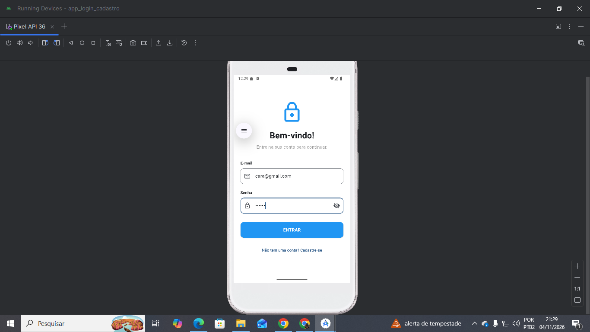
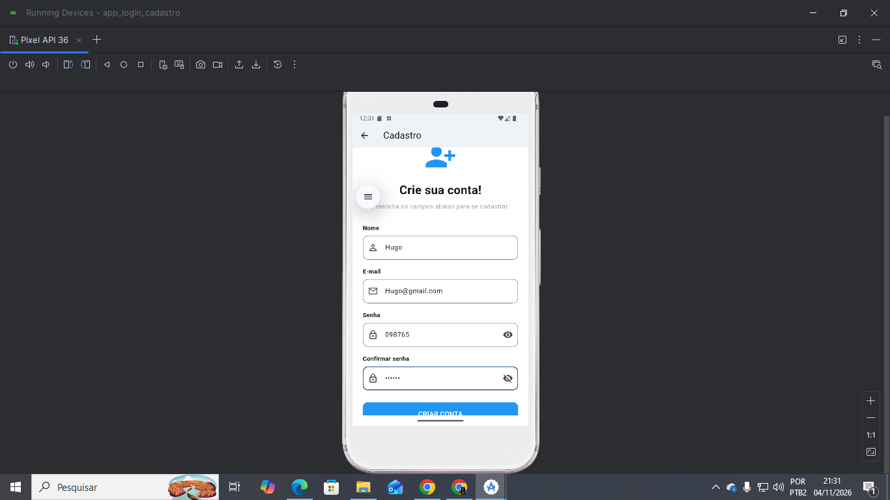
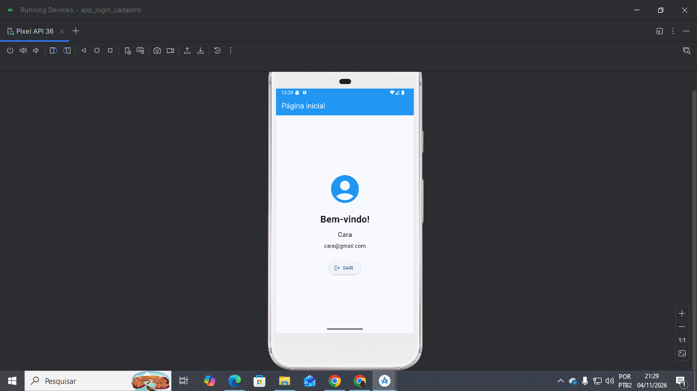

# App Login e Cadastro

Aplicativo desenvolvido em Flutter com integração ao Firebase Authentication, permitindo o cadastro e o login de usuários por e-mail e senha.

## Etapa 1 — Estrutura inicial, Login e Cadastro

### O que foi desenvolvido

- Criação da estrutura inicial do projeto Flutter.
- Configuração e integração com o Firebase.
- Ativação da autenticação por e-mail e senha no Firebase Authentication.
- Desenvolvimento da tela de login.
- Desenvolvimento da tela de cadastro de usuários.
- Validação dos campos de nome, e-mail, senha e confirmação de senha.
- Implementação do acesso à tela inicial após o login.
- Implementação da funcionalidade de sair da conta.
- Tratamento de erros durante o login e o cadastro.

### Tecnologias utilizadas

- Flutter
- Dart
- Firebase Core
- Firebase Authentication
- Android Studio

### Histórias de usuário

As histórias de usuário e seus critérios de aceitação estão documentados na Wiki deste repositório.

## Capturas de tela

### Tela de Login

### Tela de Cadastro

### Tela Inicial

### Vídeo de apresentação

Link do vídeo de apresentação: https://youtu.be/dRHBYxJx7oY

### Declaração de uso de Inteligência Artificial

Foi utilizada a ferramenta ChatGPT como apoio durante o desenvolvimento do projeto, auxiliando na compreensão dos conceitos, na resolução de problemas, na implementação de funcionalidades e na organização da documentação. O código foi analisado e testado pela equipe.

